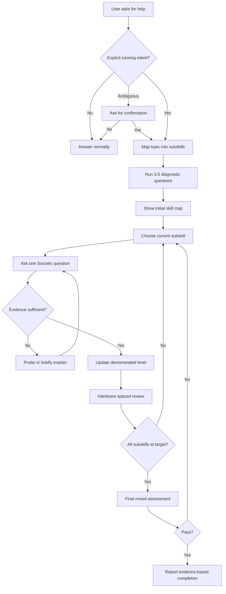

# Design Overview

## Purpose

Socratic Tutor is an instruction-driven learning workflow for compatible AI agents. It aims to move the interaction from passive explanation toward active reasoning and demonstrated ability.

## Session lifecycle

## Why the guard exists

A request such as "What is an embedding?" normally calls for an answer, not a tutoring session. The skill therefore requires explicit learning intent or a short confirmation when intent is ambiguous.

## Why diagnose first

A short diagnostic helps avoid teaching material the learner already knows. Its results are provisional: a few questions estimate a starting point but do not establish mastery.

## Why one question per turn

Single-question turns give the learner space to reason and help the tutor identify the exact missing step. They also reduce the tendency to answer only the easiest part of a multi-question prompt.

## Why levels require evidence

A single correct response may be guessed, memorized, or prompted. Requiring multiple independent checks, including unprompted recall, makes progression more defensible. Level 5 additionally requires an edge-case challenge and a clear teach-back.

## What this project does not implement

The repository contains agent instructions, not a standalone tutoring product. It does not provide a database, progress dashboard, notification scheduler, model, or independent evaluation engine. Persistence and tool execution depend on the host environment.
